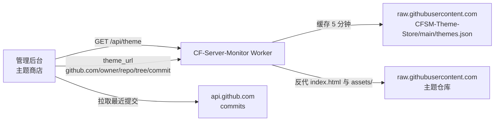

<div align="center">

# CFSM-Theme-Store

[CF-Server-Monitor](https://github.com/huilang-me/CF-Server-Monitor) 的第三方主题商店索引。

<p>
  <a href="https://github.com/huilang-me/CF-Server-Monitor">主项目</a>
  |
  <a href="https://github.com/huilang-me/CF-Server-Monitor/blob/main/theme-develop.md">主题开发文档</a>
  |
  <a href="https://github.com/huilang-me/CF-Server-Monitor/blob/main/theme-ai-prompt.md">主题开发 AI 提示词</a>
</p>

</div>

## 项目简介

CF-Server-Monitor 是一个基于 Cloudflare Workers、D1 和 Durable Objects 的轻量级多服务器监控面板。面板内置默认主题，同时支持在管理后台的「主题商店」中浏览、预览并一键切换第三方主题。

本仓库就是该主题商店的唯一数据源：`themes.json` 是主题清单，由每个 Worker 通过 `/api/theme` 代理并缓存，管理后台据此渲染主题卡片；具体版本由前端实时从 GitHub API 获取。

主题本身不存放在本仓库，仓库只保存索引，主题源码与构建分支仍归各自作者所有。

## 目录

- [工作原理](#工作原理)
- [目录结构](#目录结构)
- [提交主题](#提交主题)
- [themes.json 字段](#themesjson-字段)
- [版本获取](#版本获取)
- [主题开发要求](#主题开发要求)
- [常见问题](#常见问题)
- [免责声明](#免责声明)
- [许可证](#许可证)

## 工作原理



1. 管理后台打开主题商店，前端请求 Worker 的 `GET /api/theme`。
2. Worker 以 5 分钟 TTL 缓存并返回本仓库 `main` 分支的 `themes.json`；`X-CFSM-Theme-Source` 会标记本次结果来自 `cache` 还是 `raw`。
3. 前端按清单渲染主题卡片。点击「加载版本」时，由浏览器直接调用 `api.github.com` 拉取该主题指定分支的最近 10 条提交，默认选中最新一条。
4. 预览或应用主题时，前端把 `https://github.com/<owner>/<repo>/tree/<commit>` 写入外观设置。Worker 只反代该路径下的 `index.html` 与 `assets/`，管理后台始终由内置默认主题接管。
5. 由于地址固定到 commit，主题资源可按不可变资源长期缓存。

因此本仓库不承担流量，也不需要部署服务：它只是一份公开可读的 JSON 清单。

## 目录结构

```
CFSM-Theme-Store/
├── themes.json              # 主题清单，Worker 读取的唯一入口
└── LICENSE
```

## 提交主题

1. **确认主题可用**：主题仓库需要有一个只包含构建产物的分支（例如 `build`、`dist`、`theme-dist`），根目录下只有 `index.html` 和 `assets/`。Worker 只会反代这两个路径，其他文件不会生效。
2. **按规范开发**：路由、`Powered by` 页脚、CSP、`API_BASE` 等约定见 [主题开发要求](#主题开发要求) 与主项目的 `theme-develop.md`。
3. **准备封面图**：清单中的 `cover` 必须是可直接访问的 HTTPS 图片地址，推荐放在主题仓库的 `docs/` 下并通过 `raw.githubusercontent.com` 引用。
4. **修改 `themes.json`**：在 `themes` 数组中追加一条记录，保持文件为合法 JSON（2 空格缩进，中文用 `description.zh-CN`）。
5. **提交 Pull Request**：说明主题名称、仓库地址、构建分支与截图。合并后最长 5 分钟内会在各 Worker 的主题商店生效（Worker 缓存 TTL 为 300 秒）。

建议在 PR 中一并说明主题是否使用 Vue、是否有额外依赖、是否需要主题专属设置项，方便审核。

## themes.json 字段

顶层结构：

| 字段       | 类型     | 说明            |
| -------- | ------ | ------------- |
| `schema` | number | 清单版本，当前为 `1` |
| `themes` | array  | 主题条目列表        |

单个主题条目：

| 字段            | 必填 | 说明                                                                 |
| ------------- | -- | ------------------------------------------------------------------ |
| `id`          | 是  | 主题唯一标识，建议小写英文，改动会导致前端选中状态失效                                        |
| `title`       | 是  | 展示名称                                                               |
| `cover`       | 是  | 封面图 HTTPS 地址                                                       |
| `tags`        | 否  | 标签数组，用于卡片上的标签展示                                                    |
| `description` | 是  | 多语言描述对象，至少提供 `zh-CN`，建议同时提供 `en`                                    |
| `url`         | 是  | 主题 GitHub 仓库地址，必须是 `https://github.com/<owner>/<repo>` 形式           |
| `branch`      | 是  | 存放构建产物的分支名，如 `build`、`dist`                                         |
| `author`      | 否  | 作者名，展示为 `by <author>`                                              |

示例：

```json
{
  "id": "pulse",
  "title": "Pulse",
  "cover": "https://raw.githubusercontent.com/loongkong/cf-server-monitor-theme-pulse/main/docs/preview.svg",
  "tags": ["Pulse", "Minimal", "Mono"],
  "description": {
    "zh-CN": "极简风格的 CF Server Monitor 主题。",
    "en": "A minimal CF Server Monitor theme."
  },
  "url": "https://github.com/loongkong/cf-server-monitor-theme-pulse",
  "branch": "main",
  "author": "loongkong"
}
```

`url` 只填写仓库根地址，不要带 `/tree/<branch>`、查询参数或结尾 `/`；分支统一写在 `branch` 字段。

## 版本获取

清单不记录版本信息，版本完全由前端从 GitHub API 获取：

1. 用户点击「加载版本」。
2. 前端请求 `https://api.github.com/repos/<owner>/<repo>/commits?sha=<branch>&per_page=10`。
3. 每条提交转换为一个可选版本，标题为提交首行加日期，`short_version` 取 SHA 前 7 位。
4. 默认选中最新一条，`theme_url` 为 `https://github.com/<owner>/<repo>/tree/<sha>`，保存后按 commit 固定，不会随分支移动而变化。

含义与限制：

- 主题发布新提交后，商店无需改动清单即可看到新版本；反过来，无法在清单里锁定或隐藏某个版本。
- 浏览器必须能访问 `api.github.com`，请求超时为 8 秒，失败时会提示检查网络或更换节点。
- `branch` 必须是包含构建产物的分支，否则拉到的是源码提交，反代出的 `index.html` 与 `assets/` 无法正常渲染。
- 未登录 GitHub API 时受匿名速率限制（按 IP 计算），同一网络下频繁加载版本可能被临时限流。

## 主题开发要求

以下约定来自主项目的 `theme-develop.md`，提交前请逐条确认：

- 产物目录只生成 `index.html` 和 `assets/`，不要依赖根目录其他文件或其他主题目录。
- 静态资源放在 `assets/` 下，HTML/JS/CSS 中使用 `/assets/...` 或相对 `assets/...` 引用。
- 国旗与系统图标使用默认皮肤的静态文件（`/flags/<code>.svg`、`/os-icons/<filename>`），不要打包进主题。
- 站点标题、背景图、自定义 `<head>`、自定义脚本由用户后台设置控制，主题不要写死。
- 路由保持：首页 `/#/`、详情页 `/#/server/:id`、后台 `/admin#/admin`；第三方主题不得实现管理页。
- 页脚展示 `Powered by CF-Server-Monitor` 并链接主项目，建议同时输出 `/api/config` 的 `version`。
- 纯静态部署时通过 `<meta name="apiBase">` 配置后端地址，并在 Worker 的 `CORS_ALLOWED_ORIGINS` 中加入主题域名。
- 主题不可用时应暴露加载错误，不要在主题内静默跳转。

完整的 API、WebSocket、鉴权与字段定义见主项目 [theme-develop.md](https://github.com/huilang-me/CF-Server-Monitor/blob/main/theme-develop.md)。

## 常见问题

**主题商店加载失败或一直转圈？**
Worker 侧 `/api/theme` 依赖 `raw.githubusercontent.com`，前端获取版本依赖 `api.github.com`。若面板所在网络无法访问这两个域名，主题列表或版本列表会加载失败，可更换节点后重试。

**合并了 PR 但商店里看不到？**
Worker 对清单缓存 300 秒，等待约 5 分钟后刷新；若仍不可见，确认合并的是 `main` 分支，且 `themes.json` 仍是合法 JSON。

**预览正常，应用后白屏？**
通常是主题产物引用了 `assets/` 之外的路径，或构建产物根目录不是 `index.html` + `assets/`。Worker 只反代这两个路径。

**可以放非 GitHub 的主题吗？**
不可以。清单 `url`、`theme_url` 和反代逻辑都只接受 `https://github.com/<owner>/<repo>` 形式。

## 免责声明

本仓库只提供主题索引，不对第三方主题的代码做安全审计。第三方主题可能包含恶意代码，请在确认来源可信或审核源码后再使用；因使用第三方主题造成的任何后果由使用者自行承担。

## 许可证

[MIT](LICENSE)
